# FLOP GPU Miner Setup Guide (Devnet)

**English** | [Türkçe](Turkce-Kurulum.md)

> [!WARNING]
> **Update, 12 November 2026:** the guide now uses worker v0.1.336, FLOP's newest release. It
> takes paid sessions only with an encrypted evidence store: without one, every session gets
> `503 session evidence publication unavailable`. Step 9 and the guide's `docker-compose.yml` now
> set this up. On FLOP's public RPC, v0.1.336 answers the gateway's health checks too slowly and
> many are cancelled; [step 20](#20-speed-patch-for-worker-v01336) fixes this, and
> [step 19](#19-install-the-tunnel-watch) keeps the tunnel address up to date. If you set up before
> this date, follow [Updating to a New Release](#updating-to-a-new-release).
>
> **Update, 9 November 2026:** when the worker cannot confirm a transaction it sent, for example
> because the RPC connection dropped, it locks itself (`miner signer is fenced`) and takes no new
> sessions. The lock never opens by itself. The guard in [step 18](#18-install-the-fence-guard)
> opens it once the chain shows it is safe. If you set up before this date, do step 18.
>
> **Update, 8 November 2026:** the worker was missing the `SESSION_COMMIT_IDS` setting, which
> FLOP's miner docs leave out. Without it, sessions stop with
> `V2 leaf cannot bind a TOPLOC activation commitment (fail closed)` and the miner is never paid.
> The guide's files now have this setting. If you set up before this date, apply
> [this fix](#v2-leaf-cannot-bind-a-toploc-activation-commitment-fail-closed).
>
> **Update, 7 November 2026:** the devnet moved to runtime version 1014014 at 05:23 UTC. CLI
> v0.1.220, which this guide used before, does not work with it: `model fetch` and `miner status`
> stop with `Unsupported runtime spec version 1014014`. The guide now uses CLI v0.1.290. If you
> started the setup before this date, apply [this fix](#unsupported-runtime-spec-version-1014014).

This guide is for anyone who wants to rent a virtual machine (VM) with an NVIDIA GPU on Vast.ai
and run a GPU miner on the FLOP Devnet.

FLOP is a network where AI agents pay to get answers from AI models. A miner's machine runs a
model on its GPU, answers the jobs the network sends, and produces data that proves the work was
really done with the registered model.

At the end of the setup, two programs run on the server:

- `backend`: runs the model on the GPU (vLLM and TOPLOC).
- `worker`: takes jobs from the network, signs the answers with the miner account and reports
  them to the chain.

The FLOP Devnet opened to everyone on 3 November 2026. You do not need an application or an
invitation to become a miner. The network covers the stake needed to register, so you do not
have to buy or deposit any FLOP.

> [!IMPORTANT]
> The devnet is a test network. It gives no rewards and no airdrop points, and it can be reset.
> The goal here is to have your machine ready on day one when the testnet opens. There is no
> FLOP token yet: anything that says "buy", "claim" or "mint" is a scam. Never share your seed
> phrase. All official links are on https://flop.finance/official/.

> [!NOTE]
> Steps 1 to 17 were tested end to end on 3 November 2026 on two separate Ubuntu 22.04 VMs on
> Vast.ai, one with 1x RTX 5090 and one with 1x RTX 5060 Ti. Both passed calibration. The outputs
> in the images come from the RTX 5090 setup. Step 18 was added on 9 November 2026 and tested on a
> running RTX 5060 Ti miner. Worker v0.1.336 with the evidence store and steps 19 and 20 were
> tested on 12 November 2026 on a running RTX 3090 miner.

---

## Overview

| Item | Value |
| --- | --- |
| Network | FLOP Devnet |
| Role | GPU Miner (SOFT tier, no extra hardware attestation needed) |
| Model | Qwen/Qwen2.5-0.5B-Instruct (BF16) |
| Stake | Covered by the network: 1,000,000 devnet FLOP at first registration |
| Reward | None (devnet) |
| Official miner docs | https://docs.flop.network/docs/run-miner |
| Explorer | https://explorer.devnet.flop.network/mining |
| RPC | `wss://rpc.devnet.flop.network` |

---

## System Requirements

| Part | Requirement |
| --- | --- |
| GPU | NVIDIA, at least 16 GB VRAM |
| Driver | NVIDIA driver with CUDA 13.0 support (580 or newer) |
| Machine | A full virtual machine (VM) that can run Docker, or your own server |
| Disk | At least 60 GB free. The finished setup used 31 GB |
| Operating system | Ubuntu 22.04 or 24.04 |
| Internet | The model program alone is a 23 GB download |

### Tested Cards

| Card | VRAM | Vast.ai price per hour | Calibration |
| --- | --- | --- |
| RTX 5060 Ti | 16 GB | About $0.20 | Accepted, 130 GFLOP/s |
| RTX 5090 | 32 GB | About $0.70 | Accepted, 200 GFLOP/s |

The most affordable option is the 16 GB RTX 5060 Ti. The prices include disk; internet traffic
is charged separately. These are the prices on 3 November 2026 and they vary by machine.

You can also use other cards and other providers that meet the requirements above. If you use
Vast.ai, pick a template with the **VM** tag. Docker does not run on the normal templates.

---

## 1. Create an SSH Key

You will connect to the server from your own computer over SSH. For that you need an SSH key.

### Windows:

- First, set up WSL if you are on Windows (search for a current WSL install guide).
- After completing the WSL setup, run the commands below in the WSL terminal.

### macOS:

- Run the commands below in the Terminal app.

```bash
ssh-keygen -t ed25519 -C "vast-flop"
```

- Press Enter to accept the default answers.
- If you already have a key, answer `n` to `Overwrite (y/n)?` and use your existing key.

Print your public key:

```bash
cat ~/.ssh/id_ed25519.pub
```

Copy the whole line that starts with `ssh-ed25519`. This line is not secret; it is what you give
to Vast.ai. Never share the `id_ed25519` file in the same folder (the one without `.pub`).

---

## 2. Vast.ai Account and SSH Key

1. Open the [Vast.ai sign up and login page](https://cloud.vast.ai/?ref_id=222215) and sign in.
2. Go to **Billing** in the left menu and add credit with **Add Credit**.

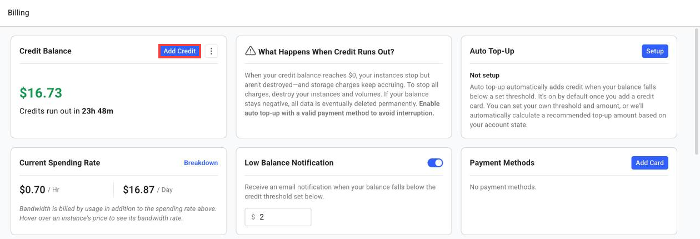

3. Go to **Keys** in the left menu.
4. On the **SSH Keys** tab, click **+ New**.
5. Paste the `ssh-ed25519 ...` line you copied and click **Save**.

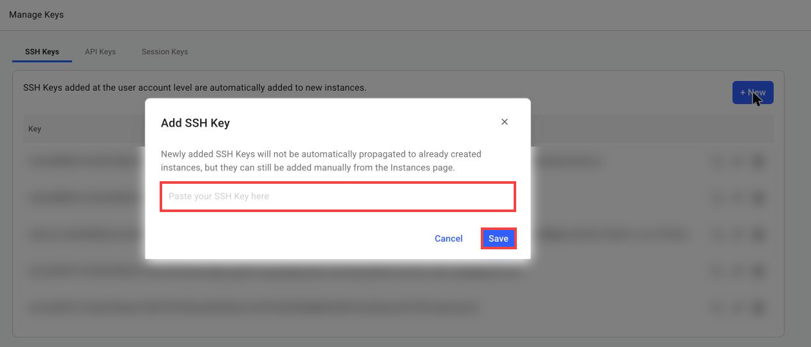

Keys on your account are added automatically to every server you rent from now on. A key added
after a server is rented is not added to that server.

---

## 3. Rent a VM

1. Go to **Search** in the left menu.
2. In the template box on the left, click **Change Template**.
3. Under **Tags** at the top right, choose the **VM** tag.
4. Click the ▶ button under the **Ubuntu 22.04 VM** template.

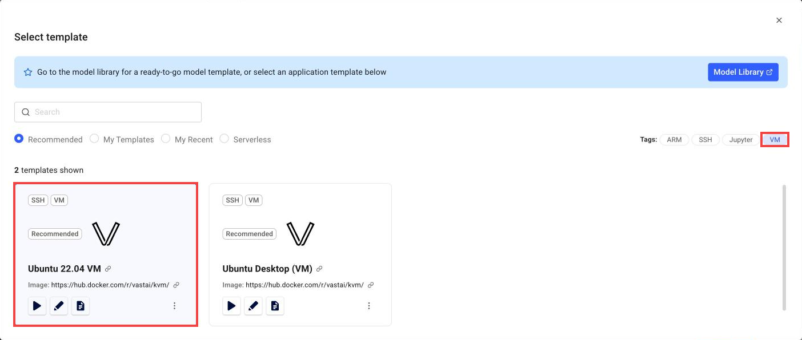

5. In the filters at the top, choose **On-Demand**, **RTX 5060 Ti** or **RTX 5090** as the GPU,
   and your region.
6. Check that the machine's `Max CUDA` value is `13.0` or higher.
7. Hover over the price to see the total hourly cost.

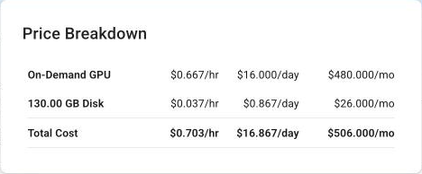

8. Click **RENT** on a suitable machine.

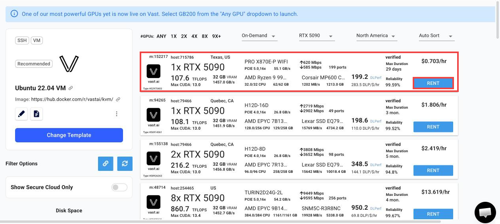

When choosing a machine, look at:

- The GPU model and count
- The `Max CUDA` value (13.0 or higher)
- The reliability rate (Reliability)
- The total hourly cost and the internet cost
- The longest rental time (Max Duration)

> [!IMPORTANT]
> **Stop** pauses the GPU cost, but the disk cost continues. **Destroy** deletes the server and
> all its files for good. If your credit runs out, the server stops.

---

## 4. Connect to the Server

1. Go to **Instances** in the left menu.
2. Wait for the server to start. Vast says a VM can take up to 30 minutes to start. In the test,
   the RTX 5090 server started within 2 minutes.
   If the server does not start for a long time, or its status becomes `exited`, delete it with
   **Destroy** and rent another machine. The first RTX 5060 Ti I tried never started; the second
   one started without problems.
3. When the server is up, click the **>_Connect** button.

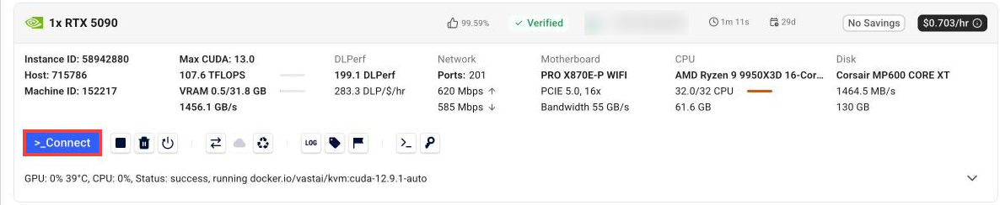

4. Copy the command on the **Direct SSH Connect** line.

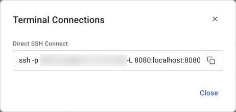

5. Paste the command into your own computer's terminal. The `-L 8080:localhost:8080` part at the
   end is not needed; you can delete it.

```bash
ssh -p PORT root@SERVER_IP
```

- `PORT` and `SERVER_IP` are in the command Vast gives you.
- On the first connection, answer `yes` to `Are you sure you want to continue connecting (yes/no)?`.

From here on, every command runs on the server.

---

## 5. Check the GPU and Docker

```bash
nvidia-smi --query-gpu=name,driver_version,memory.total --format=csv
docker --version && docker compose version
```

You should see your card's name, a driver version of `580` or newer, and the Docker versions:

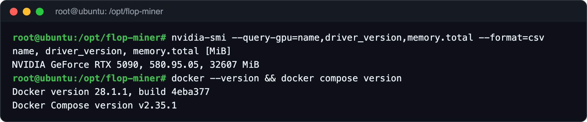

---

## 6. Install the NVIDIA Container Toolkit

Docker comes ready on a Vast VM, but the tool that connects the graphics card to Docker is
missing. Without it the programs cannot see the GPU and you get this error:
`could not select device driver "" with capabilities: [[gpu]]`

```bash
apt-get update && apt-get install -y nvidia-container-toolkit
nvidia-ctk runtime configure --runtime=docker
systemctl restart docker
```

Test that the GPU is visible inside Docker:

```bash
docker run --rm --gpus all nvidia/cuda:13.0.1-base-ubuntu22.04 nvidia-smi --query-gpu=name,driver_version,memory.total --format=csv
```

If the last line shows your card's name, this step is done:

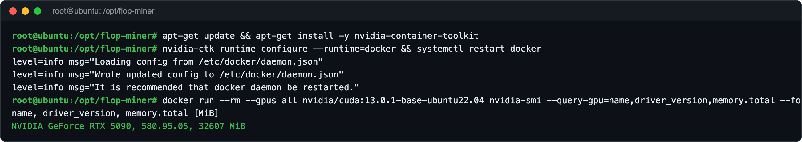

---

## 7. Download the Guide Files and Prepare the Settings

```bash
cd ~
git clone https://github.com/CuriQusEth/flop-miner-setup.git
mkdir -p /opt/flop-miner/models
cp flop-miner-setup/docker-compose.yml flop-miner-setup/miner.env.example flop-miner-setup/sponsor.mjs /opt/flop-miner/
cd /opt/flop-miner
install -m 600 miner.env.example miner.env
```

Create the secret values in the settings file and give your miner a name:

```bash
sed -i "s/^INFERENCE_API_KEY=.*/INFERENCE_API_KEY=$(openssl rand -hex 32)/" miner.env
sed -i "s/^SESSION_AUTH_TOKEN=.*/SESSION_AUTH_TOKEN=$(openssl rand -hex 32)/" miner.env
sed -i "s/^WORKER_NAME=.*/WORKER_NAME=your-miner-name/" miner.env
```

- Replace `your-miner-name` with a name for your miner. Use letters, numbers and dashes.

Add the two shortcuts the next steps use:

```bash
cat >> ~/.bashrc <<'EOF'
export FLOP_CLI="$(grep '^FLOP_CLI=' /opt/flop-miner/miner.env 2>/dev/null | cut -d= -f2-)"
compose() { docker compose --env-file /opt/flop-miner/miner.env -f /opt/flop-miner/docker-compose.yml "$@"; }
flop() { docker run --rm --network host -e FLOP_KEY_PASSWORD -v /opt/flop-miner:/work "$FLOP_CLI" "$@"; }
EOF
source ~/.bashrc
```

- `compose`: manages the miner programs (backend and worker).
- `flop`: FLOP's official command line tool. The `/opt/flop-miner` folder appears inside it as
  `/work`.

---

## 8. Download the FLOP Programs

```bash
docker pull "$FLOP_CLI"
compose pull
```

The model program (`miner-vllm-toploc`) is 23 GB. In the test, the three programs took 3.5
minutes to download.

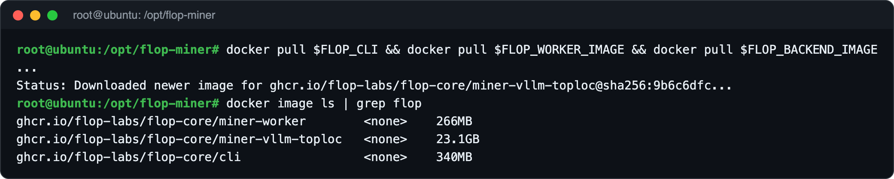

---

## 9. Create the Miner Wallet

The miner has an account of its own. The signatures on its work and its stake belong to this
account.

```bash
cd /opt/flop-miner
umask 077
flop keys generate --type sr25519 --show-secret --json > /root/miner-key.json
jq -r .mnemonic /root/miner-key.json > /opt/flop-miner/signer
chmod 600 /opt/flop-miner/signer
jq -r .address /root/miner-key.json
```

The last command prints your miner address (it starts with `5`). Save this address somewhere.

Print the 24 words once and write them down on paper, then delete the temporary file:

```bash
cat /opt/flop-miner/signer
rm /root/miner-key.json
```

Create the session key:

```bash
install -d -m 700 /opt/flop-miner/session-keys
sh -c 'umask 077; openssl rand -hex 32 > /opt/flop-miner/session-keys/enclave.seed'
```

Create the evidence key. From worker v0.1.336 on, the worker keeps the evidence of every paid
session in an encrypted store and takes paid sessions only when it has one. This file is the key
of that store:

```bash
install -d -m 700 /opt/flop-miner/audit-key
sh -c 'umask 077; openssl rand -hex 32 > /opt/flop-miner/audit-key/evidence.key'
```

> [!CAUTION]
> The `signer` file is your miner account itself. Never send it to anyone, never take a
> screenshot of it and never upload it to GitHub. If the worker cannot find this file, it tries
> to run with FLOP's public test account `//Alice`. In step 14, make sure the `Signer:` line in
> the log shows your own address.

---

## 10. Register with the Stake Sponsor

On the devnet, FLOP covers the miner stake itself. This command signs a request with your miner
account and sends it to FLOP's sponsor service. The sponsor registers your account as a miner and
deposits the stake.

```bash
docker run --rm -v /opt/flop-miner:/work --entrypoint node "$FLOP_CLI" /work/sponsor.mjs
```

If you see `HTTP 200` and `"success":true`, the registration is done. The network deposits
1,000,000 test FLOP as stake and 250 test FLOP for transaction fees into your account:

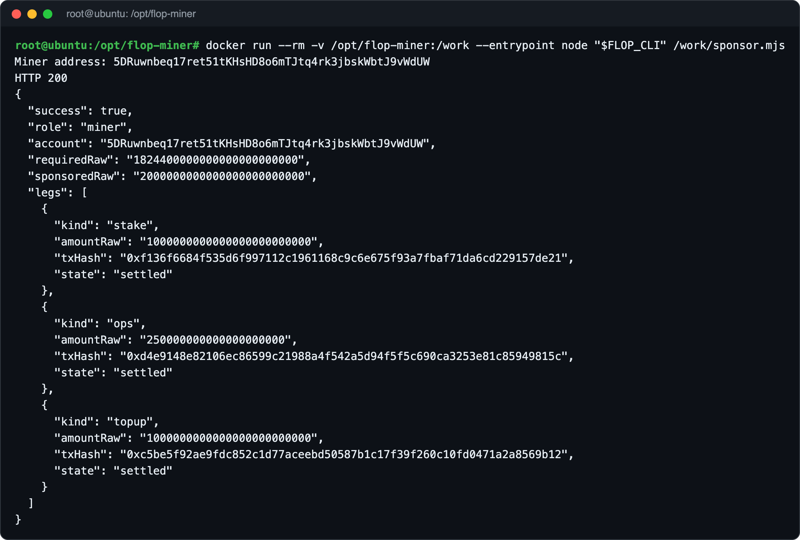

- Do not run `flop miner register` yourself. The sponsor already registers you.
- `429` with the message `automatic miner sponsorship is full` means the sponsor is full right
  now. At most 40 sponsored miners can wait for calibration at the same time, and the sponsor takes
  at most 100 new miners a day. A slot opens when one of them calibrates. Run the same command
  again after a while. If you get `503`, also try again after a while.
- A registered miner holds one of these places until it calibrates. Continue with the next steps
  right after this one.
- Faster cards need more stake. If you run the same command once more, the sponsor tops the stake
  up to at most 2,000,000 test FLOP. In the test, 1,000,000 was enough for the RTX 5060 Ti; the
  RTX 5090 needed the second request.

---

## 11. Download and Verify the Model

FLOP's tool downloads the model and compares the files with the record on the chain. If they do
not match the record exactly, it does not write the files.

```bash
flop --network devnet --rpc wss://rpc.devnet.flop.network model fetch 0x1a52c1abe781db051e70ae357f72bb70161ca0c092df0b618f22a9292ba63306 --precision BF16 --output-dir /work/models/qwen2.5-0.5b-instruct --json
```

You should see `"ok": true` and a `verified_root` value equal to the model hash (without the `0x`).
The picture shows the older CLI, where this value was called `computed_root`:

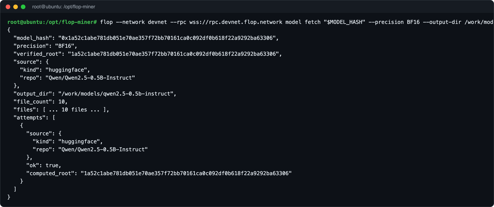

If the first attempt fails with `MODEL_VERIFICATION_FAILED` and `fetch failed`, run the same
command again. In the test, the first attempt gave this error and the second one worked.

If the error says `Unsupported runtime spec version`, your CLI is older than the chain: apply
[this fix](#unsupported-runtime-spec-version-1014014).

---

## 12. Start the Backend

```bash
cd /opt/flop-miner
compose up -d backend
compose logs -f backend
```

When the log shows the `MODEL_DIR reproduces MODEL_HASH` and `Uvicorn running` lines, the model
is loaded on the GPU. Leave the logs with `CTRL + C`; the program keeps running.

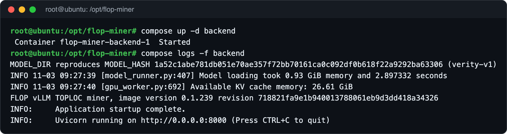

Run the backend health check:

```bash
compose exec -T backend python3 -c 'import os, json, urllib.request as u; r=json.loads(u.urlopen(u.Request("http://127.0.0.1:8000/health", headers={"Authorization": "Bearer " + os.environ["INFERENCE_API_KEY"]})).read()); print(json.dumps({k: r.get(k) for k in ("model_identity","model_hash","precision","decode_policy_hash","image")}, indent=2))'
```

`model_identity` should be `measured` and the model hash should match the one in step 11:

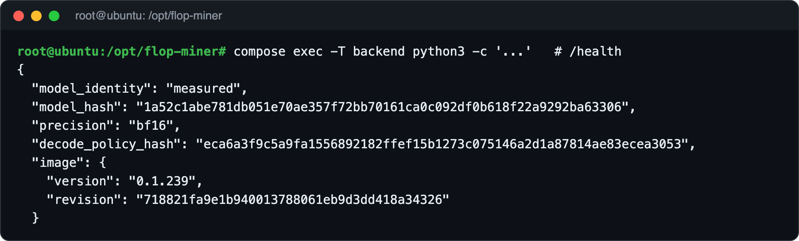

---

## 13. Set Up the HTTPS Tunnel

The network needs an HTTPS address to reach your miner. Ports 80 and 443 cannot be opened
directly on Vast, so we use Cloudflare's free tunnel. You do not need an account.

```bash
cd ~
curl -fsSL -o cloudflared.deb https://github.com/cloudflare/cloudflared/releases/latest/download/cloudflared-linux-amd64.deb
dpkg -i cloudflared.deb
```

Install the tunnel as a service that keeps running even when the server restarts:

```bash
sudo tee /etc/systemd/system/flop-tunnel.service > /dev/null <<'EOF'
[Unit]
Description=FLOP miner HTTPS tunnel
After=network-online.target
Wants=network-online.target

[Service]
ExecStart=/usr/bin/cloudflared tunnel --no-autoupdate --url http://127.0.0.1:8645
Restart=always
RestartSec=5

[Install]
WantedBy=multi-user.target
EOF
systemctl daemon-reload
systemctl enable --now flop-tunnel
```

Wait a few seconds and see your tunnel address:

```bash
journalctl -u flop-tunnel --no-pager | grep -o 'https://[a-z0-9-]*\.trycloudflare\.com' | tail -1
```

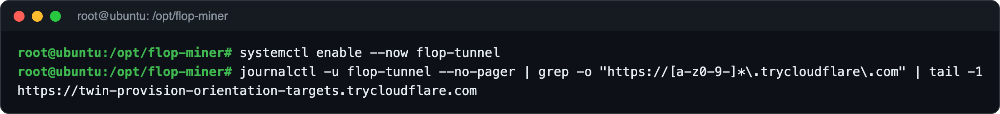

Write the address into the settings file:

```bash
H=$(journalctl -u flop-tunnel --no-pager | grep -o '[a-z0-9-]*\.trycloudflare.com' | tail -1)
sed -i "s/^SESSION_PUBLIC_HOST=.*/SESSION_PUBLIC_HOST=$H/" /opt/flop-miner/miner.env
grep '^SESSION_PUBLIC_HOST=' /opt/flop-miner/miner.env
```

> [!NOTE]
> This free tunnel gets a new address whenever the tunnel restarts. If it changes, run the last
> three commands again and restart the worker with `compose up -d worker`, or install the tunnel
> watch from [step 19](#19-install-the-tunnel-watch), which does this for you.

---

## 14. Start the Worker

```bash
cd /opt/flop-miner
compose up -d worker
compose logs -f worker
```

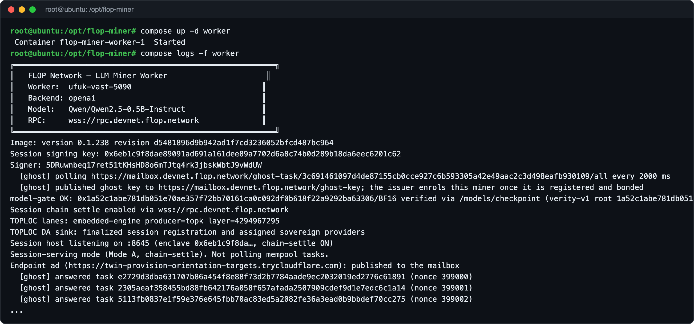

Check these lines in the log:

| Line | Meaning |
| --- | --- |
| `Image: version 0.1.336` | The worker version |
| `Signer: 5...` | Must be the miner address you created in step 9 |
| `[ghost] published ghost key` | The key the network sends test jobs to is published |
| `model-gate OK` | The model matches the record on the chain |
| `Session host listening on :8645` | The worker is listening for requests |
| `Endpoint ad (...): published to the mailbox` | Your tunnel address is announced to the network |
| `[ghost] answered task ...` | The test jobs the network sends are being answered |

---

## 15. Check Everything

Send a request to your tunnel address from your own computer.

(The rest of the detailed steps, troubleshooting, fence-guard, tunnel-watch, speed patch, and update sections remain the same as the original guide, with all download links now pointing to this repository.)

---

## Official Links

- FLOP Miner Docs: https://docs.flop.network/docs/run-miner
- Getting Started for GPU Owners: https://docs.flop.network/docs/run-gpu-provider
- Explorer Miner Page: https://explorer.devnet.flop.network/miner
- Release List: https://flop.network/releases.json
- Bug Reports: https://github.com/flop-labs/network
- Official Links: https://flop.finance/official/

---

## Disclaimer

This guide is not investment advice and is not an official FLOP Labs guide. The devnet gives no
rewards and can be reset. GPU rental, disk and internet costs are yours. Before running the
commands, check the current versions in FLOP's official docs.

---

Maintained by [@wilson_syo](https://x.com/wilson_syo). Feel free to reach out with questions.
